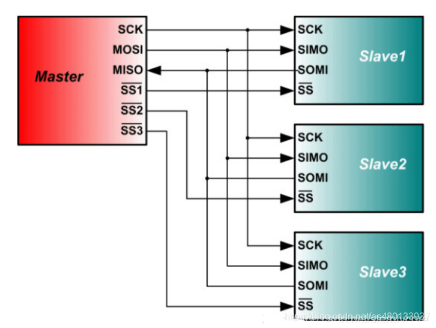
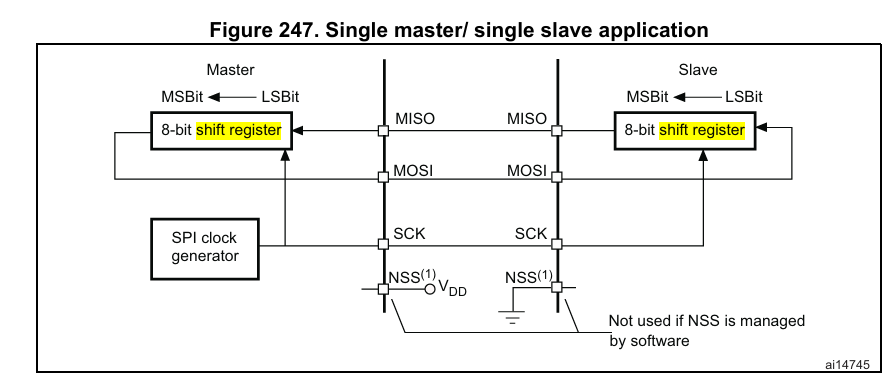
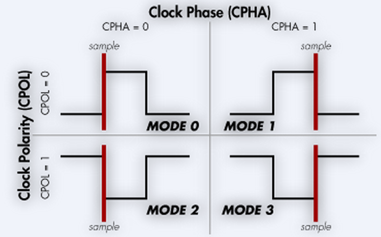
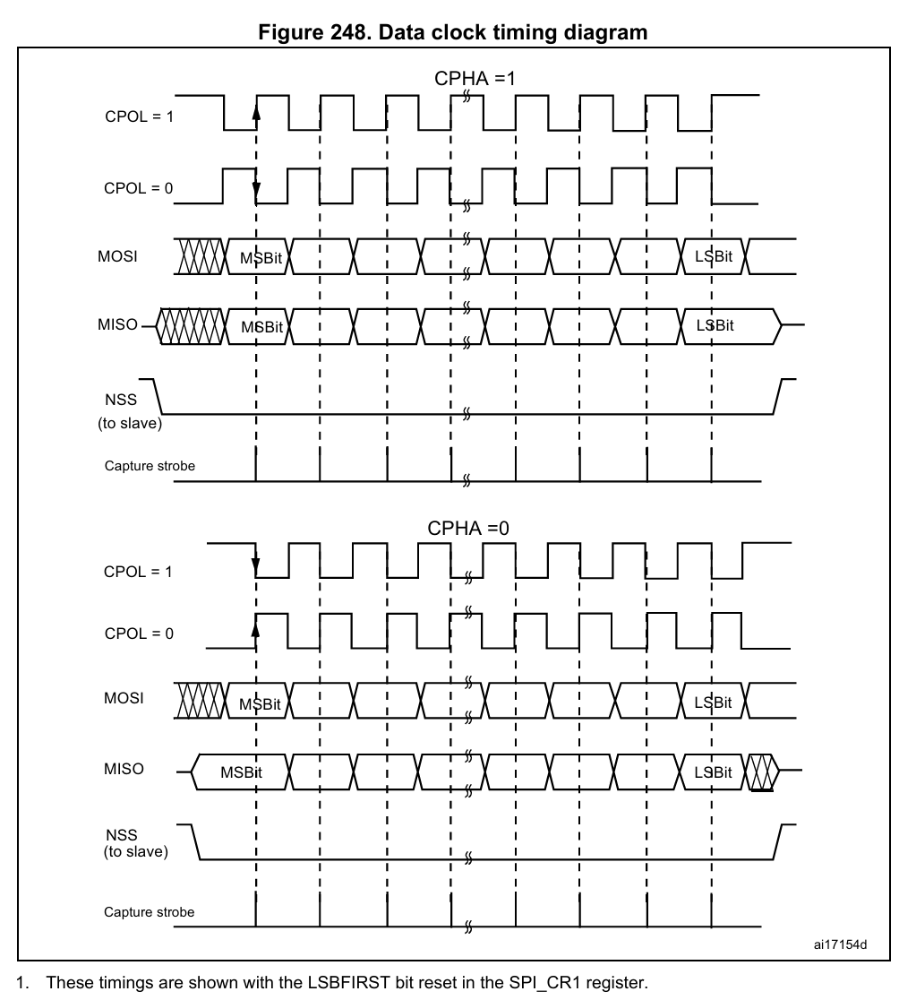
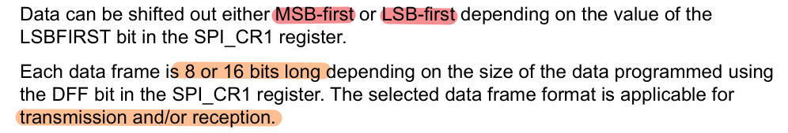
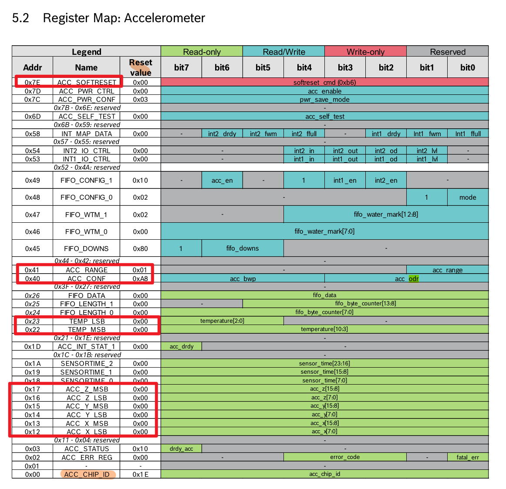
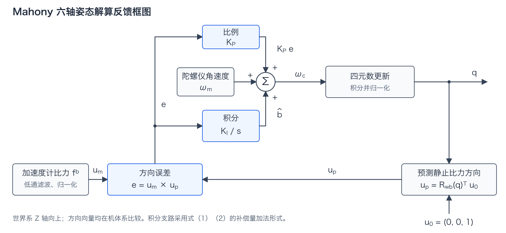
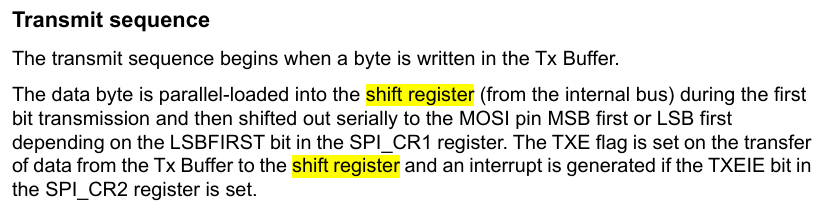
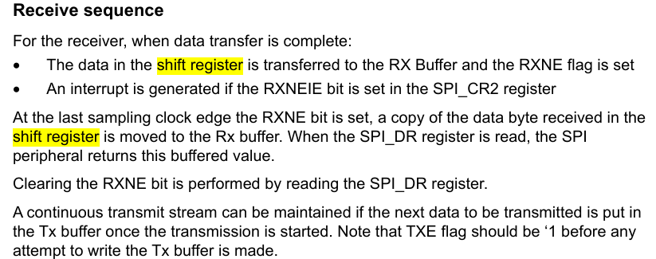

# 10\.18 SPI IMU

> goal
> 用 C 板实现 STM32F407 与 BMI088 的 SPI 通信，读取并理解加速度计和陀螺仪数据，再用这些数据估计姿态。
> 
> 

# 正文

## 一、IMU 是什么？它能测什么？

静止时，期望得到的加速度计值和陀螺仪值是多少？为什么？

IMU 能够直接测量行驶速度吗？

**BMI088 是六轴 IMU，三轴加速度计测比力，三轴陀螺仪测角速度。它不直接输出行驶速度或姿态角。**

|传感器|输出量|常用单位|板子静止时的理想读数|
|---|---|---|---|
|加速度计|三轴比力，即单位质量所受的非重力作用力|`g` 或 `m/s²`|三轴读数的模约为 `1 g`，各轴分量取决于朝向|
|陀螺仪<br>|绕三轴的角速度<br>|`°/s` 或 `rad/s`|三轴均为 `0`<br>|

静止指**板子相对地面（世界坐标系）静止**；实际的读数会叠加零偏、噪声和温漂。

### 陀螺仪的工作原理与用途

MEMS 陀螺仪通过科里奥利效应测量角速度。内部的质量块沿驱动方向往复振动；传感器旋转时，质量块在检测方向产生与角速度有关的响应，电路将其转换为角速度读数。[MEMS 原理参考](https://www.analog.com/en/resources/technical-articles/accelerometer-and-gyroscopes-sensors-operation-sensing-and-applications.html)

机械陀螺的转子由于角动量守恒会保持原有的方向；BMI088 用的是上面的 MEMS 原理。科里奥利效应不限于地球上的运动：在旋转参考系中，物体的相对运动可能受到这种效应影响，方向取决于旋转轴和运动方向。

陀螺仪测量物体**绕**三个正交轴（x、y、z）的角速度，也就是绕各轴旋转的速率。绕固定轴转动时，对角速度积分可以得到角度变化。三维转动还要按姿态运动学更新，不能直接把三个轴的积分分别当成 Roll、Pitch、Yaw。

积分时，陀螺仪的零偏也会累积，所以板子静止时，算出的角度仍可能慢慢变化。解算前需要考虑零偏校准，长期运行还需要其他观测量修正漂移。

### 加速度计的工作原理与用途

MEMS 加速度计通常用弹簧支撑一个微型质量块。传感器外壳运动或受到支撑力时，质量块相对外壳移动，电路检测位移引起的电容变化，再换算为比力。[MEMS 原理参考](https://www.analog.com/en/resources/technical-articles/accelerometer-and-gyroscopes-sensors-operation-sensing-and-applications.html)

加速度计测到的比力，与物体在地面坐标系中的运动加速度有区别。忽略误差，把各向量都写在同一个坐标系中，有：

$\mathbf{f} = \mathbf{a} - \mathbf{g}$

其中，$\mathbf{f}$ 是加速度计测得的比力，$\mathbf{a}$ 是物体的运动加速度，$\mathbf{g}$ 是重力加速度向量。传感器朝向变化时，还要使用**旋转矩阵**把读数从传感器坐标系转到所用坐标系。[比力与导航计算参考](https://www.analog.com/en/resources/analog-dialogue/articles/2019/02/19/16/38/strapdown-inertial-navigation-system-based-on-an-imu-and-a-geomagnetic-sensor.html)

板子放在桌面上静止时，$\mathbf{a}=0$，加速度计三轴读数的模约为 $1\,g\approx9.8\,\mathrm{m/s^2}$。理想自由落体时，$\mathbf{a}=\mathbf{g}$，读数约为零。

板子静止，或运动加速度较小时，可以用读数方向估计倾角。加速、制动或振动时，读数还会受运动影响，这时不能直接用它判断重力方向。[倾角测量的条件见 AN\-1057](https://www.analog.com/en/resources/app-notes/an-1057.html)

### 为什么不能直接读出行驶速度？

IMU 不直接测量速度。已知初始速度、姿态和采样时间，完成坐标变换和重力补偿后，可以对运动加速度积分来估计速度。但零偏和姿态误差也会随积分累积，影响速度估计。

姿态相同时，静止和理想匀速直线运动的瞬时 IMU 读数相同，单看读数区分不了。六轴 IMU 不适合单独用来长期测速，这里先用它做姿态解算。

## 二、SPI 的信号线与片选

**这里用单主机、多从机的四线 SPI。主机产生时钟，用独立的片选信号选择从机。**

SPI（Serial Peripheral Interface）是串行外设接口。STM32F407 是主机（Master），BMI088 的加速度计和陀螺仪是两个分别片选的从机（Slave）。

|信号|含义|方向与作用|
|---|---|---|
|MISO|Master In Slave Out|从机向主机发送数据|
|MOSI|Master Out Slave In|主机向从机发送数据|
|SCK<br>|Serial Clock|主机产生的串行时钟，旧图中的 SCLK 表示同一信号|
|CS / SS|Chip Select / Slave Select|主机选择从机；BMI088 的片选低电平有效|

多个从机通常共用 SCK、MOSI 和 MISO，片选线各用一根。一次只选中一个从机，避免它们同时驱动 MISO。




## 三、SPI 的通信流程

只读数据时，主机为什么也要发送？

**四线全双工 SPI 每个时钟周期同时发一位、收一位。主机读数据也要产生时钟，就像一个圈，有进有出。**

STM32F407 作为主机时，全双工传输的流程如下：

1. 拉低目标从机的片选，保持其他从机的片选为高电平。

2. 主机向 `SPI_DR` 写入待发送数据，数据进入发送缓冲区（Tx Buffer）。

3. 数据从发送缓冲区装入移位寄存器后，`TXE` 置 `1`，发送缓冲区可以接收下一帧数据。

4. 主机产生 SCK，移位寄存器按配置的位序从 MOSI 发出数据，同时从 MISO 采样输入。

5. 一帧的 8 或 16 位接收完成后，数据转入接收缓冲区（Rx Buffer），`RXNE` 置 `1`。

6. 读取 `SPI_DR` 获取接收数据。全部数据传输完成后，再释放片选。

读取寄存器时，主机先发读取命令和地址，再发占位数据来产生时钟，同时接收从机返回的数据。至于具体占位数据发什么、收到的哪些字节要丢弃，需要看器件手册。

没被片选的从机不参与这次寄存器读写，内部仍能继续采样、更新数据寄存器。BMI088 的加速度计和陀螺仪读取时序不同，后面的连接与配置部分再讲这个区别。




## 四、CPOL 与 CPHA：什么时候采样？

SCK 的上升沿和下降沿，哪一个用来采样数据？

**CPOL 决定 SCK 空闲电平，CPHA 决定在第一个还是第二个跳变沿采样；两者组合后才能确定具体采样边沿。**

STM32F407 通过 `SPI_CR1` 中的 `CPOL` 和 `CPHA` 配置四种 SPI 时序模式。

|参数|取值|含义|
|---|---|---|
|CPOL，Clock Polarity（时钟极性）|`0`|SCK 空闲时为低电平|
|CPOL，Clock Polarity（时钟极性）|`1`|SCK 空闲时为高电平|
|CPHA，Clock Phase（时钟相位）|`0`|在第一个跳变沿采样，对应 CubeMX 的 `1 Edge`|
|CPHA，Clock Phase（时钟相位）|`1`|在第二个跳变沿采样，对应 CubeMX 的 `2 Edge`|

第一个跳变沿指 SCK 离开空闲电平的边沿；第二个跳变沿指 SCK 返回空闲电平的边沿。

|模式|CPOL|CPHA|SCK 空闲电平|采样边沿|
|---|---|---|---|---|
|Mode 0|`0`|`0`|低|上升沿|
|Mode 1|`0`|`1`|低|下降沿|
|Mode 2|`1`|`0`|高|下降沿|
|Mode 3|`1`|`1`|高|上升沿|







主从机要按器件要求配置时序模式。BMI088 支持 Mode 0 和 Mode 3，见 BMI088 数据手册 §6\.1，第 47 页。

## 五、数据帧长度与位序

“8 位数据帧”和“高位优先”是不是同一项配置？

**数据帧长度决定一次传输 8 位还是 16 位，位序决定先发送最高有效位还是最低有效位；这两项分别配置。**

|参数|对应寄存器位|取值与含义|
|---|---|---|
|数据帧格式，Data Frame Format|`SPI_CR1.DFF`|`0`：8 位；`1`：16 位|
|传输位序|`SPI_CR1.LSBFIRST`|`0`：MSB first，高位优先；`1`：LSB first，低位优先|

高位或低位优先说的是一帧\*里哪一位先发**。**多个字节在连续寄存器中怎么排列，还要另看 BMI088 手册，解包时不要混在一起。




## 六、C 板与 BMI088 的连接和配置

### 1）Brief Intro

- RoboMaster C型开发板中搭载了一个BMI088 6轴惯性测量单元，搭配了减震结构的设计；同时增加了温控电路，可以改善IMU的温漂问题。

- BMI088是一款博世（Bosch Sensortec）推出的高性能惯性测量单元（IMU），其中包括3轴加速度计和3轴陀螺仪和温度传感器


### 2）相关参数配置

BMI088 Data Sheet *Page7 Specification* 部分可以看到 加速度计、陀螺仪、温度传感器的各种参数，这些参数在读数据并**换算**时会用到，可选参数的设置也和应用场景有关。

- Range：量程可选

- Sensitivity：灵敏度，即传感器读数变化1，对应实际物理量的变化

- ODR\(output data rate\)
数据输出频率

- OSR\(over sampling rate\)
过采样率，内部为了生成一个数据点，对更多原始采样点进行平均\(滤波\)。OSR越高，数据越平滑\(噪声小\)，但响应延迟更大。

- BW\(Bandwidtch range\)带宽
系统增益从最大值下降\-3 dB时所对应的截止频率之间的宽度


- 加速度计BW受ODR，OSR的影响：
OSR相同的情况下，高输出高采样使其能捕获更高带宽的信号成分。
ODR相同的情况下，高OSR意味着更强的滤波和更平滑的数据，也会有更低的带宽。


- 软复位

    - 功能: 大体上等同于一次断电重新上电，会将所有传感器配置参数恢复默认值。

    - 执行方式:
    加速度计和陀螺仪可以独立地进行软复位，复位方式就是向目标寄存器 `ACC_SOFTRESET`/`GYRO_SOFTRESET`中写入`0xB6`的指令。
    


### 4）Register Maps 寄存器表

- BMI088的通信是通过读写**寄存器**实现的

    - 寄存器宽度为 8 bits

    - 加速度计和陀螺仪有2套不同的寄存器表

    - SPI模式下，对acc/gyro的选择是通过片选 CS\(chip select\) 实现的
    


> Register Map 详见 BMI088 Data Sheet page25\(acc\) 和 page36\(gyro\)
> 
> 

#### Register Map of Accelerometer

`0x00` Chip ID: 默认`0x1E`

`0x12`\-`0x17` ACC data: 换算 page27


`0x7E` `ACC_SOFTRESET` page35

软复位指令为`0xB6`


`0x41` `ACC_RANGE` page30

Acc 量程设置

`0x40` `ACC_CONF` page29

Acc滤波OSR设置，ODR设置


Register Map 加速度计寄存器表




#### Register Map of Gyroscope

`0x02`\-`0x07` Rate Data

- 计算Rate


- Rate映射到实际物理量：映射到`0x0F`中选择的`GYRO_RANGE`


`0x14` `GYRO_SOFTRESET`


`0x00` Chip ID

`0x0F` `GYRO_RANGE` 量程


`0x10` `GYRO_BANDWIDTH`


### 5）BMI088 的 SPI通信配置

#### 5\.1）BMI088 通信模式选择 SPI/IIC

- BMI088支持两种通信方式 SPI/IIC\.

datasheet中可以看到通过PS引脚可以选择其中一种，而C板用户手册中显示PS已经接地，选择了SPI通信方式。


#### 5\.2）Spi Timing

- 最高通信频率是10MHz


- CPOL和CPHA：

    - 支持CPOL=0 CPHA=0 / CPOL=1 CPHA=1两种，都是上升沿采样

    - 会在CS被拉低瞬间检测SCK时钟线电平自动判断是哪一种


#### 5\.3）陀螺仪 SPI通信


- 如果是连续读取，只需要给首位地址即可

#### 5\.4）加速度计的 SPI通信

***与陀螺仪读取存在区别！***


- 初始化阶段
陀螺仪的模式直接由PS引脚电平选择，1***但加速度计时钟以IIC启动，需要通过在CS引脚上发送一个上升沿来主动切换到SPI模式***。所以为了将传感器改为SPI模式，可以执行一次虚拟读取操作，例如读chip\-id，但此时获取值是**无效的**

- 后续读取操作
加速度计***不会在主设备发送读取指令后直接返回请求的信息***，而是会先发一个dummy byte，之后才是有效信息


- 具体操作上，每次读取时需要忽略一个dummy byte\(内容是不可预测的\)，再读取后面的有效信息

---

### STM32CubeMX 设置

#### 选择芯片

STM32F407IGH6TR


#### RCC，SYS，时钟树和定时器

rcc和sys与之前一致，时钟树配置为168MHz

定时器可以选择 `tim6(APB1)`，利用 $fclk/(prescaler+1)/(couter period+1)$ 得到1kHz的定时器，记得打开中断

#### 配置SPI

1. Mode

    - 选择Full\-Duplex Master，全双工通信，以F407作为Master，Gyro和Acc作为Slave

    - Hardware NSS Signal：Disable，为分别控制BMI088的加速度计和陀螺仪，需禁用SPI的硬件NSS，并使用两个GPIO作为软件控制的片选引脚

2. Parameter Settings

    - Frame Format选择默认Motorola（摩托罗拉）

    - Data Size：选择8bit，First Bit 选择 MSB
    


    - Prescaler：选择合适的值使 baudrate\<10MHz，可以给到256

    - CPOL CPHA 可以选择 CPOL=1\(High\)，CPHA=1\(2edge\)

3. GPIO Settings

    - 确认SPI1\_MOSI\(PA7\), SPI1\_MISO, SPI1\_CLK是否对应原理图中的引脚（默认可能不对）

    - 将PA4和PB0按照原理图里一样设置为GPIO output，并默认拉高\(拉低则开启通信\)
    

        


### 代码实现

#### 1\) bmi088 R/W

```c
// 参考
HAL_StatusTypeDef HAL_SPI_Transmit(SPI_HandleTypeDef *hspi, uint8_t *pData, uint16_t Size, uint32_t Timeout); // blocking mode, IT/DMA better
HAL_StatusTypeDef HAL_SPI_Receive(SPI_HandleTypeDef *hspi, uint8_t *pData, uint16_t Size, uint32_t Timeout);

// 尝试完成 ↓
void bmi088_write_byte(uint8_t tx_data) {
  HAL_SPI_Transmit(&hspi1, &tx_data, 1, 1000);
}
void bmi088_read_byte(uint8_t *rx_data, uint8_t length);

void bmi088_write_reg(uint8_t reg, uint8_t data); // 向寄存器中写入数据，可参考5.3，5.4寄存器写入方法，先写首位判别符+地址，再写data
```

#### 2\) chip selection

```c
void BMI088_ACCEL_NS_L(void) {
  HAL_GPIO_WritePin(CS1_ACCEL_GPIO_Port, CS1_ACCEL_Pin, GPIO_PIN_RESET);
}
void BMI088_ACCEL_NS_H(void);
void BMI088_GYRO_NS_L(void);
void BMI088_GYRO_NS_H(void);
```

#### 3\) Accel/Gyro R/W

```c
// 参考: acc写入，相当于加上片选的 bmi088_write_reg 函数
void bmi088_accel_write_single_reg(uint8_t reg, uint8_t data) {
  BMI088_GYRO_NS_H();
  BMI088_ACCEL_NS_L();

  bmi088_write_byte(reg & 0x7F);
  bmi088_write_byte(data);

  BMI088_ACCEL_NS_H();
}

// 尝试完成 ↓
void bmi088_accel_read_reg(uint8_t reg, uint8_t *rx_data, uint8_t length); // 加速度计读取，注意需要忽略第一个字节dummy byte
void bmi088_gyro_read_reg(uint8_t reg, uint8_t *rx_data, uint8_t length); // 陀螺仪读取
void bmi088_gyro_write_single_reg(uint8_t reg, uint8_t tx_data); // gyro写入
```

#### 4\) BMI088 初始化

**初始化顺序：切换加速度计 SPI 模式 → 软复位 → 检查 Chip ID → 开启测量 → 配置参数 → 读回检查。**

可以copy paste，置于主程序中。前面的片选和读写函数要先补完，在 `MX_GPIO_Init()`、`MX_SPI1_Init()` 之后调用 `bmi088_init()`。返回 `1` 表示初始化通过。

加速度计上电后先以IIC模式启动，第一次读取只是为了让CS出现上升沿，读到的值不用。软复位后也再做一次虚拟读取，和 Bosch 官方驱动的处理一致。这个虚拟读取和每次读取时要丢掉的 dummy byte 是两件事。

|器件|寄存器|读写|作用|写后等待|
|---|---|---|---|---|
|加速度计|`ACC_SOFTRESET`（`0x7E`）|写 `0xB6`|软复位|`1 ms`|
|陀螺仪|`GYRO_SOFTRESET`（`0x14`）|写 `0xB6`|软复位|`30 ms`|
|加速度计|`ACC_CHIP_ID`（`0x00`）|读 `0x1E`|检查器件与通信|—|
|陀螺仪|`GYRO_CHIP_ID`（`0x00`）|读 `0x0F`|检查器件与通信|—|
|加速度计|`ACC_PWR_CONF`（`0x7C`）|写 `0x00`|Active mode，退出 suspend|`5 ms`|
|加速度计|`ACC_PWR_CTRL`（`0x7D`）|写 `0x04`|开启加速度计|`5 ms`|
|加速度计|`ACC_RANGE`（`0x41`）|写 `0x01`|±6 g|`1 ms`|
|加速度计|`ACC_CONF`（`0x40`）|写 `0xAB`|ODR 800 Hz，Normal 滤波，BW 为 x/y 230 Hz、z 200 Hz|`40 ms`|
|陀螺仪|`GYRO_LPM1`（`0x11`）|写 `0x00`|Normal mode|`30 ms`|
|陀螺仪|`GYRO_RANGE`（`0x0F`）|写 `0x00`|±2000 °/s|`1 ms`|
|陀螺仪|`GYRO_BANDWIDTH`（`0x10`）|写 `0x02`，读 `0x82`|ODR 1000 Hz，BW 116 Hz|`10 ms`|

这里的配置等待时间参考了 [Bosch SensorAPI](https://github.com/boschsensortec/BMI08x_SensorAPI/blob/master/bmi08a.c)，量程写入后留 `1 ms` 间隔。`GYRO_BANDWIDTH` 的 bit 7 是只读位，固定为 1，所以读回时只检查低三位。

> Note: bit \#7 is read\-only and always ‚1‘, but has no function and can safely be ignored\.
> 
> 

```c
uint8_t bmi088_init(void) {
  uint8_t dummy = 0;
  uint8_t acc_id = 0;
  uint8_t gyro_id = 0;
  uint8_t acc_power[2] = {0};
  uint8_t acc_config[2] = {0};
  uint8_t gyro_config[3] = {0};

  BMI088_ACCEL_NS_H();
  BMI088_GYRO_NS_H();
  HAL_Delay(1);

  // Switch ACCEL to SPI，第一次读到的值不用
  bmi088_accel_read_reg(0x00, &dummy, 1);
  HAL_Delay(1);

  // Soft Reset ACCEL
  bmi088_accel_write_single_reg(0x7E, 0xB6);
  HAL_Delay(1);

  // Soft Reset GYRO
  bmi088_gyro_write_single_reg(0x14, 0xB6);
  HAL_Delay(30);

  // ACCEL 软复位后再做一次虚拟读取
  bmi088_accel_read_reg(0x00, &dummy, 1);
  HAL_Delay(1);

  // Check Chip ID
  bmi088_accel_read_reg(0x00, &acc_id, 1);
  if (acc_id != 0x1E) {
    return 0;
  }
  bmi088_gyro_read_reg(0x00, &gyro_id, 1);
  if (gyro_id != 0x0F) {
    return 0;
  }

  // Switch ACCEL to Active Mode
  bmi088_accel_write_single_reg(0x7C, 0x00); // ACC_PWR_CONF
  HAL_Delay(5);
  bmi088_accel_write_single_reg(0x7D, 0x04); // ACC_PWR_CTRL
  HAL_Delay(5);

  // ACCEL Range / ODR / BW
  bmi088_accel_write_single_reg(0x41, 0x01); // ACC_RANGE
  HAL_Delay(1);
  bmi088_accel_write_single_reg(0x40, 0xAB); // ACC_CONF
  HAL_Delay(40);

  // GYRO Power / Range / ODR / BW
  bmi088_gyro_write_single_reg(0x11, 0x00); // GYRO_LPM1
  HAL_Delay(30);
  bmi088_gyro_write_single_reg(0x0F, 0x00); // GYRO_RANGE
  HAL_Delay(1);
  bmi088_gyro_write_single_reg(0x10, 0x02); // GYRO_BANDWIDTH
  HAL_Delay(10);

  // Read back，连续读取相邻的配置寄存器
  bmi088_accel_read_reg(0x7C, acc_power, 2);
  if (acc_power[0] != 0x00 || acc_power[1] != 0x04) {
    return 0;
  }
  bmi088_accel_read_reg(0x40, acc_config, 2);
  if (acc_config[0] != 0xAB || (acc_config[1] & 0x03) != 0x01) {
    return 0;
  }
  bmi088_gyro_read_reg(0x0F, gyro_config, 3);
  if ((gyro_config[0] & 0x07) != 0x00 ||
      (gyro_config[1] & 0x07) != 0x02 || gyro_config[2] != 0x00) {
    return 0;
  }

  return 1;
}
```

如果返回 `0`，可以在对应的 `return 0` 处打断点，看是 Chip ID 不对，还是哪个配置没有写进去。加速度计读回的数据应当已经在 `bmi088_accel_read_reg()` 中去掉 dummy byte。

寄存器定义见 [BMI088 数据手册](https://jiaoloong.feishu.cn/file/WeLEbdR2CoiaR3xhxdBcVj1xnuh) §3（第 13 页）、§4\.4\.1（第 16 页）、§5\.3\.1、§5\.3\.10–5\.3\.11、§5\.3\.20–5\.3\.22（第 26、29–30、34–35 页）、§5\.5\.1、§5\.5\.5–5\.5\.8（第 37、39–40 页）。软复位后的虚拟读取和配置等待时间参考 [Bosch SensorAPI 的加速度计实现](https://github.com/boschsensortec/BMI08x_SensorAPI/blob/c1ed227e7bb7da1fa600bbd4e5c82d0da1eb416a/bmi08a.c#L630)、[陀螺仪实现](https://github.com/boschsensortec/BMI08x_SensorAPI/blob/c1ed227e7bb7da1fa600bbd4e5c82d0da1eb416a/bmi08g.c#L396)和[延时常量](https://github.com/boschsensortec/BMI08x_SensorAPI/blob/c1ed227e7bb7da1fa600bbd4e5c82d0da1eb416a/bmi08_defs.h#L576)。

---

## 七、解包与单位换算

### 1\. imu 数据换算

```c++
void IMU::acc_calculate(){
 // 1. 设置/读取acc0x41寄存器中的量程range参数，并换算为量程系数
 bmi088_accel_read_reg(0x41, &raw_range, 1);
 // code here

 // 2. 读取acc0x12寄存器中的6位acc数据
  bmi088_accel_read_reg(0x12, rx_acc_data, 6);

 // 3. 用量程系数将原始数据转换为常用单位
 // code here
}

void IMU::gyro_calculate(){
  // 1. 设置/读取gyro0x0F寄存器中的量程range参数，并换算为量程系数
  // 2. 读取gyro0x02寄存器中的6位gyro数据
  // 3. 用量程系数将原始数据转换为常用单位
}
```

## 八、时间、坐标系与校准

现在，能够读取imu的数据了（加速度计和陀螺仪）

如何对数据进行进一步的处理？

### IMU 安装方向变换

**IMU 安装方向变换，就是把传感器坐标系下的三轴读数，换成机器人机体坐标系下的读数。** IMU 固定在机器人上以后，这个变换矩阵也就固定了。

#### 安装方向与变换矩阵

传感器坐标系记作 $s$，机体坐标系记作 $b$

```cpp
const float R_imu[3][3] = {{-1.0f, 0.0f, 0.0f},
                         {0.0f, 1.0f, 0.0f},
                         {0.0f, 0.0f, -1.0f}};
```

这里的 `R_imu` 用来把传感器系读数转到机体系，含义如下：

|传感器的正轴|在机体系中的表示|
|---|---|
|$x_s$|$-x_b$|
|$y_s$|$+y_b$|
|$z_s$|$-z_b$|

写成矩阵就是：

$\mathbf v^b=R_{\mathrm{imu}}\mathbf v^s,\qquad R_{\mathrm{imu}}=\begin{bmatrix}-1&0&0\\0&1&0\\0&0&-1\end{bmatrix}$

也就是 X、Z 分量取反，Y 分量不变。这个矩阵对应参考工程的板载 IMU 配置，换一种安装方向，就要根据传感器轴与机体轴的对应关系重新填写。

**加速度计和陀螺仪都要做方向变换。**

#### 代码实现

```cpp
void IMU::sensorDataTransform(void) {
  for (uint8_t i = 0; i < 3; i++) {
    gyro_sensor_[i] = raw_data_.gyro[0] * R_imu_[i][0] +
                      raw_data_.gyro[1] * R_imu_[i][1] +
                      raw_data_.gyro[2] * R_imu_[i][2] - gyro_bias_[i];
    accel_sensor_[i] = accel_sen_ * (raw_data_.accel[0] * R_imu_[i][0] +
                                     raw_data_.accel[1] * R_imu_[i][1] +
                                     raw_data_.accel[2] * R_imu_[i][2]) -
                       accel_bias_[i];
  }
}
```

循环中的 `i` 表示输出的机体轴。每次取 `R_imu_` 的一行，与传感器的三个分量相乘、相加，得到这个机体轴上的分量。

|变量|含义|单位|
|---|---|---|
|`raw_data_.gyro`|方向变换前的三轴角速度|rad/s|
|`raw_data_.accel`|方向变换前的三轴比力|m/s²|
|`R_imu_`|从配置中复制进 IMU 对象的安装方向矩阵|无量纲|
|`gyro_sensor_`、`accel_sensor_`|方向变换、校准后，送入姿态算法的数据|rad/s、m/s²|
|`gyro_bias_`、`accel_bias_`|在变换后的机体系中扣除的偏置|rad/s、m/s²|
|`accel_sen_`|加速度计的比例修正系数|无量纲|

虽然变量名里有 `raw_data_`，但其实已经做了单位换算，这里存的不是寄存器中的整数。同样，`gyro_sensor_`、`accel_sensor_` 虽然带着 `sensor`，经过这一步后已经是机体系下的数据。

把代码写成公式，就是：

$\boldsymbol\omega^b=R_{\mathrm{imu}}\boldsymbol\omega^s-\mathbf b_g^b,\qquad\mathbf f^b=k_aR_{\mathrm{imu}}\mathbf f^s-\mathbf b_a^b$

其中 $\boldsymbol\omega$ 是角速度，$\mathbf f$ 是比力，$k_a$ 对应 `accel_sen_`。**这段代码先变换方向，再扣除偏置。（思考一下有没有更好的做法）** 因此，偏置必须和减法前的数据使用同一坐标系、同一单位；

在 `IMU::update()` 中，相关处理顺序是：

**读取并换算单位 → 安装方向变换 → 加速度比例修正、扣除偏置 → Mahony 姿态解算**

#### 如何检查旋转矩阵是否正确

对上面的方向矩阵，静止时把指定的**机体正轴朝上**，检查加速度计读数。先忽略偏置，令比例修正系数为 1，取 $g=9.8\ \mathrm{m/s^2}$，理想结果如下：

|放置方式|`raw_data_.accel`，单位 m/s²|`accel_sensor_`，单位 m/s²|
|---|---|---|
|机体 $+X$ 朝上|$(-9.8,0,0)$|$(9.8,0,0)$|
|机体 $+Y$ 朝上|$(0,9.8,0)$|$(0,9.8,0)$|
|机体 $+Z$ 朝上|$(0,0,-9.8)$|$(0,0,9.8)$|

陀螺仪再单独检查：按右手定则，分别绕机体 X、Y、Z 轴正向转动，`gyro_sensor_` 对应轴的角速度应为正。旋转矩阵不改变单位，这里的结果仍是 rad/s。

只检查水平静止时的 Z 轴不够，X、Y 轴也要分别检查，才能确认三个轴的对应关系。

### IMU的零漂校准

#### 零漂

**陀螺仪静止时，读数的平均值也可能不为 0，这个偏差就是零偏。** 带着这个偏差积分，即使机器人不动，算出来的角度也会慢慢变化。

**解决方法：让 IMU 静止采样，三轴分别求平均，作为零偏；后续读数再减去它。** 记采样点数为 $N$，三轴角速度为 $\boldsymbol\omega_m$，则：

$\mathbf b_g=\frac{1}{N}\sum_{k=1}^{N}\boldsymbol\omega_{m,k},\qquad\boldsymbol\omega_{\mathrm{corrected}}=\boldsymbol\omega_m-\mathbf b_g$

校准时先等温度稳定，并保持 IMU 静止，避免把实际转动也算进零偏。沿用前面代码的坐标系，取方向变换后、扣除旧零偏前的数据求平均，再存入 `gyro_bias_`。不同次上电的零偏可能有变化，可以在每次上电后重新估计。

这里说的是陀螺仪。加速度计静止时仍有重力对应的比力，不能直接把三轴均值都当成零偏扣掉。

#### 温漂

**IMU 的零偏会随温度变化。** 刚上电时标定出的零偏，等芯片温度升高后，可能就不合适了。

**解决方法：用 C 板加热电阻配合温度反馈，让 IMU 温度保持稳定。** 读取 BMI088 的温度，用 PID 调节加热电路的 PWM 占空比；先预热，等温度稳定后再做零偏校准。

这套电路只能加热，目标温度需要高于电路板正常工作时的温度。恒温可以减轻温漂，但不能代替零偏校准；温度不变时，零偏仍可能缓慢变化，随机噪声也仍然存在。

参考：[IMU原理介绍及误差分析](https://zhuanlan.zhihu.com/p/544296512) 中「误差来源」；[C 板用户手册](https://jiaoloong.feishu.cn/file/Iub2bLbFRoCP5axXIZ1cl2UUn0b)第 15 页「六轴惯性测量单元」。PWM 控温实现可看参考工程的 [TempControl::handle\(\)](https://jiaoloong.feishu.cn/file/Aq1LbVyF6oMtDNxXINDcMQINneg)。

## 九、姿态解算

有了加速度计和陀螺仪的数据，怎样表示并更新机器人的姿态？

**先选择姿态的表示方式，再用角速度更新姿态。** 这里从欧拉角讲起，再引入四元数，说明为什么程序中用四元数更新姿态，最后又输出欧拉角。

### 旋转的表达

#### 欧拉角

如何描述机器人现在的姿态？

**可以从一个初始姿态出发，依次转动三个角度，用这三个角描述最终姿态。** 本节采用右手坐标系，正角按右手定则确定，约定：

|名称|符号|本节采用的旋转顺序|
|---|---|---|
|Yaw，偏航角|$\psi$|先绕初始 Z 轴旋转|
|Pitch，俯仰角|$\theta$|再绕旋转后的 Y 轴旋转|
|Roll，横滚角|$\phi$|最后绕再次旋转后的 X 轴旋转|

这就是 $Z-Y'-X''$ 内旋。把机体系数据变到世界系的矩阵记为 $R_{wb}$，则：

$\mathbf v^w=R_{wb}\mathbf v^b,\qquad R_{wb}=R_z(\psi)R_y(\theta)R_x(\phi)$

**欧拉角必须连同旋转顺序一起看。** 只给出三个角度，却不说明绕哪些轴、按什么顺序旋转，含义并不完整。[旋转顺序与欧拉角约定参考：VectorNav §2\.4](https://www.vectornav.com/resources/inertial-navigation-primer/math-fundamentals/math-attitudetran)

#### 万向节死锁

欧拉角这么直观，为什么还要换一种表示？

**在某些姿态下，欧拉角中的两个旋转轴会平行，使两个角的作用无法独立区分。** 对上面的 $Z-Y'-X''$ 顺序，当 Pitch 为 $\pm90^\circ$ 时，第一次旋转的 Z 轴与最后一次旋转的 X 轴平行。

例如，下面两组角度表示同一个姿态，顺序均为 `(Roll, Pitch, Yaw)`：

$(0^\circ,90^\circ,0^\circ)\qquad\text{与}\qquad(20^\circ,90^\circ,20^\circ)$

这时同时改变 Roll 和 Yaw，效果可以互相抵消。接近这个位置时，物体姿态只变化一点，反算出的欧拉角却可能变化很大。

[奇异情况与旋转矩阵性质参考：NASA/JPL Rotation](https://naif.jpl.nasa.gov/pub/naif/toolkit_docs/C/req/rotation.html)

#### 轴角

前面用三次旋转到达目标姿态，能不能一次完成？

**三维空间中的任意姿态变化，都可以表示为绕某根轴旋转一个角度。** 把旋转轴的单位向量记为 $\mathbf u$，旋转角度记为 $\alpha$，就得到轴角表示：

$(\mathbf u,\alpha),\qquad \|\mathbf u\|=1$

例如，绕 Z 轴正向转 $90^\circ$，就是：

$\mathbf u=(0,0,1),\qquad \alpha=90^\circ$

这里描述的是最终的姿态变化。物体实际运动时，可以走过不同的旋转过程，最后到达同一个姿态。

#### 四元数

怎样用四元数保存旋转轴和旋转角？

**表示旋转的单位四元数，可以由轴角写出。** 把实部放在第一位：

$q=(w,x,y,z)=\left(\cos\frac{\alpha}{2},u_x\sin\frac{\alpha}{2},u_y\sin\frac{\alpha}{2},u_z\sin\frac{\alpha}{2}\right)$

所以，四个分量不是四个角。它们共同描述一根旋转轴和一个旋转角，并满足：

$w^2+x^2+y^2+z^2=1$

例如，绕 Z 轴正向转 $90^\circ$：

$q=\left(\frac{\sqrt2}{2},0,0,\frac{\sqrt2}{2}\right)$

这里的 $q$ 与 $R_{wb}$ 对应，表示机体系到世界系的姿态；两坐标系重合时，可以取 $q=(1,0,0,0)$。

#### 用四元数计算旋转

拿到四元数以后，怎样用它变换一个向量？

**把三维向量写成纯四元数，通过四元数乘法完成变换。** 令 $p^b=(0,\mathbf v^b)$，则：

$p^w=q\otimes p^b\otimes q^{-1}$

$\otimes$ 表示 Hamilton 四元数乘法。把 $q_1$、$q_2$ 分别写成实部和向量部 $(w_1,\mathbf v_1)$、$(w_2,\mathbf v_2)$，乘积记作 $(w,\mathbf v)$，则：

$\begin{aligned}w&=w_1w_2-\mathbf v_1\cdot\mathbf v_2\\\mathbf v&=w_1\mathbf v_2+w_2\mathbf v_1+\mathbf v_1\times\mathbf v_2\end{aligned}$

为什么用半角？以绕 Z 轴为例，若 $q=(\cos\beta,0,0,\sin\beta)$，把 X 轴向量代入双边乘法，结果为：

$(1,0,0)\longrightarrow(\cos2\beta,\sin2\beta,0)$

因此，要得到实际旋转角 $\alpha$，就需要取 $\beta=\alpha/2$。[轴角、半角与四元数旋转](https://arxiv.org/pdf/1711.02508)

- 单位四元数的逆等于共轭：$q^{-1}=(w,-x,-y,-z)$。

- 连续旋转通过四元数乘法组合，四元数乘法一般不具有交换律。

- $q$ 和 $-q$ 表示同一个姿态。[四元数运算参考：NASA/JPL](https://naif.jpl.nasa.gov/pub/naif/toolkit_docs/C/req/rotation.html)

#### 用角速度更新四元数

现在已经有当前姿态 $q$，也读到了角速度，下一时刻的姿态怎么算？

**利用角速度计算四元数的变化率，再按采样时间更新。** $q$ 表示机体系到世界系的姿态；$\boldsymbol\omega^b$ 是已经完成安装方向变换和零偏校准的机体系角速度。则：

$\dot q=\frac12q\otimes(0,\boldsymbol\omega^b)$

离散化：

$\tilde q_{k+1}=q_k+\frac12q_k\otimes(0,\boldsymbol\omega_k^b)\Delta t$

归一化：

$q_{k+1}=\frac{\tilde q_{k+1}}{\|\tilde q_{k+1}\|}$

|输入量|含义|单位|
|---|---|---|
|$\boldsymbol\omega^b$|机体系下的三轴角速度|rad/s|
|$\Delta t$|本次姿态更新的时间间隔|s|

[详细推导参考：Solà §4\.5–4\.6，式（198）–（212）](https://arxiv.org/pdf/1711.02508)

程序中先根据角速度和采样时间计算四元数增量，再更新当前姿态，最后归一化。这一步只使用陀螺仪，零偏仍会随积分累积；后面再讲怎样用加速度计观测到的重力方向修正姿态。

#### 为什么最后还要转回欧拉角？

内部已经用四元数表示姿态了，为什么还要输出 Roll、Pitch、Yaw？

**四元数适合在程序内部更新姿态，欧拉角方便观察和使用，旋转矩阵方便变换向量。**

|工具|用途|
|---|---|
|四元数|保存姿态、进行姿态更新|
|旋转矩阵|把角速度、比力等向量变到所需坐标系|
|欧拉角|显示姿态，在适用的角度范围内供控制使用|

数据处理过程可以写成：

四元数转回欧拉角以后，接近 Pitch 为 $\pm90^\circ$ 时，欧拉角的奇异问题仍然存在。[表示转换与欧拉角奇异性参考：VectorNav §2\.4](https://www.vectornav.com/resources/inertial-navigation-primer/math-fundamentals/math-attitudetran)

#### try

1. 拿一块板子，分别绕两个固定的空间轴旋转，再交换顺序做一次，比较最终姿态。

2. 算出绕 Z 轴正向转 $90^\circ$ 的四元数，看看它如何把 $(1,0,0)$ 变为 $(0,1,0)$。将这个四元数整体取负，再算一次，比较结果。

3. 尝试 `(Roll, Pitch, Yaw)` 为 $(0^\circ,90^\circ,0^\circ)$ 和 $(20^\circ,90^\circ,20^\circ)$ 时得到的旋转矩阵相同，并检查它的行列式。

### 一阶低通滤波

加速度计噪声很大，因此在使用数据前需要先对其进行一次一阶低通滤波的预处理，一阶低通滤波先前已经讲过，就不再赘述。

### Mahony 姿态解算

只用陀螺仪更新四元数，时间一长，姿态就会漂移。怎样利用加速度计修正这个误差？

**Mahony 利用加速度计测到的方向与当前姿态预测的方向构造误差，再用这个误差修正角速度，最后更新四元数。** 这里先讲只使用加速度计和陀螺仪的六轴解算。

#### 为什么要融合两种传感器？

陀螺仪和加速度计分别能提供什么？

**陀螺仪提供旋转的变化，加速度计在静止或线加速度较小时提供重力方向的约束。**

|传感器|能提供的信息|主要问题|
|---|---|---|
|陀螺仪|三轴角速度，可以连续更新姿态|零偏会随积分累积（即使有校准）|
|加速度计|静止时可以判断倾斜方向|运动时还包含机体加减速带来的惯性力，不能直接当成重力|

这里不需要先用加速度计算出一组欧拉角，再与另一组欧拉角求平均。可以直接比较两个方向向量。[传感器模型参考：AHRS — Sensor Models](https://ahrs.readthedocs.io/en/latest/filters/mahony.html#sensor-models)

#### 比较哪两个方向？

加速度计测到的是机体系下的比力，怎样与当前姿态进行比较？

**先把加速度计读数归一化，再根据当前四元数，算出静止时应该测到的方向。两者都在机体系下比较。**

- 世界系 Z 轴向上。

- $q=(w,x,y,z)$，实部在前，表示机体系到世界系的姿态。

- 加速度计和陀螺仪的数据已经完成安装方向变换。

静止时，重力加速度向下，加速度计测得的比力向上。因此，世界系下的参考方向为：

$\mathbf u_0=\begin{bmatrix}0\\0\\1\end{bmatrix}$

将机体系下的加速度计读数 $\mathbf f^b$ 归一化，得到测量方向：

$\mathbf u_m=\frac{\mathbf f^b}{\|\mathbf f^b\|}$

当前四元数对应的旋转矩阵为 $R_{wb}(q)$。把世界系的参考方向变到机体系，得到预测方向：

$\mathbf u_p=R_{wb}(q)^T\mathbf u_0$

展开以后：

$\mathbf u_p=\begin{bmatrix}2(xz-wy)\\2(yz+wx)\\1-2(x^2+y^2)\end{bmatrix}$

例如，机体系与世界系重合时，$q=(1,0,0,0)$，预测方向就是 $(0,0,1)$。此时板子静止，加速度计归一化后的读数也应接近这个方向。

这里比较的是**静止比力的方向**，它与重力加速度方向相反。

#### 怎样构造方向误差？

测量方向和预测方向不一致，应该向哪边修正？

**用测量方向叉乘预测方向，得到反馈误差：**

$\mathbf e=\mathbf u_m\times\mathbf u_p$

如果两个单位向量的夹角为 $\delta$，则：

$\|\mathbf e\|=\sin\delta$

方向接近时，$\sin\delta\approx\delta$，叉积可以反映小角度**误差**的**大小和方向**。

eg\. 板子实际水平，程序却认为它绕 X 轴正向倾斜了一个小角度 $\varepsilon$。此时：

$\mathbf u_m=\begin{bmatrix}0\\0\\1\end{bmatrix},\qquad\mathbf u_p\approx\begin{bmatrix}0\\\varepsilon\\1\end{bmatrix}$

所以：

$\mathbf e\approx\begin{bmatrix}-\varepsilon\\0\\0\end{bmatrix}$

把它正向加入角速度修正项，就会产生负向的 X 轴修正，使估计姿态回到水平。**写的时候注意叉乘顺序与后面反馈的正负号**

#### 用 PI 反馈修正角速度

有了误差，怎样放进前面的四元数更新公式？

**比例项根据当前误差纠偏，积分项估计剩余的陀螺仪零偏。**

记 $\boldsymbol\omega_m$ 为经过安装方向变换和前文零偏校准后的角速度，$\hat{\mathbf b}$ 为在线估计的剩余零偏：

$\left\{\begin{aligned}\boldsymbol\omega_c&=\boldsymbol\omega_m+\hat{\mathbf b}+K_P\mathbf e&&\text{（1）}\\\dot{\hat{\mathbf b}}&=K_I\mathbf e&&\text{（2）}\end{aligned}\right.$

这里的 $\hat{\mathbf b}$ 用来补偿静态校准后仍然存在的残余零偏，不要把前面求出的静态零偏重复减一次。[误差反馈与零偏估计参考：Mahony 等，§V，式（32）](https://www.mikrocontroller.net/attachment/197058/2007_Mahony.etal_TAC-06-396_v3.pdf)

|参数|作用|单位|
|---|---|---|
|$K_P$|调整当前方向误差的纠正速度|$\mathrm{s^{-1}}$|
|$K_I$|调整剩余零偏的估计速度|$\mathrm{s^{-2}}$|
|$\hat{\mathbf b}$|剩余零偏估计值|rad/s|
|$\Delta t$|本次更新的时间间隔|s|

表中将弧度视为无量纲。

为什么只有比例项还不够？以单轴小角度情况为例，如果仍有固定零偏 $b_r$，比例项就需要维持一个小的倾角误差，才能产生修正量抵消它。积分项会逐渐估计这部分零偏，使比例项不必一直靠倾角误差来补偿。

反馈关系如下，积分支路按式（1）（2）的加法形式绘制：




#### 更新四元数

修正后的角速度怎么使用？

把原来四元数更新公式中的角速度换成 $\boldsymbol\omega_c$，其余步骤相同。

按一阶离散化，每次更新先计算：

$\boldsymbol\omega_{c,k}=\boldsymbol\omega_{m,k}-\hat{\mathbf b}_k+K_P\mathbf e_k$

再更新零偏估计和四元数：

$\hat{\mathbf b}_{k+1}=\hat{\mathbf b}_k-K_I\mathbf e_k\Delta t$

$\tilde q_{k+1}=q_k+\frac12q_k\otimes(0,\boldsymbol\omega_{c,k})\Delta t$

$q_{k+1}=\frac{\tilde q_{k+1}}{\|\tilde q_{k+1}\|}$

角速度使用 **rad/s**，$\Delta t$ 使用 **s**。四元数四个分量的增量都要用同一个旧四元数计算，算完后再统一更新。


#### 调参

参数应该怎样调？

先令 $K_I=0$，确认比例反馈方向正确，再加入积分项。

先让板子静止，给程序中的初始姿态设置一个小的 Roll 或 Pitch 偏差，观察误差是否逐渐减小。方向正确后，再调整 $K_P$：增大它通常会加快纠偏，也会使加速度计噪声和运动加速度更容易影响姿态。

然后逐步加入 $K_I$，观察静止时的倾角误差和零偏估计。不要一开始就用较大的积分增益，否则运动加速度造成的方向误差也容易进入零偏估计。

上电时最好在静止状态下，用加速度计初始化倾斜姿态；

#### 六轴 Mahony 的限制

加上 Mahony 以后，三个角就都不会漂了吗？

**重力只能约束倾斜，不能确定绕重力方向的绝对航向。** 因此，六轴 Mahony 无法保证 Yaw 长期不漂移；静止时，也不能靠重力估计沿重力方向的陀螺仪零偏。

另外，加速度计测到的是比力。存在明显线加速度时，归一化后的方向会偏离静止参考方向，算法可能把这部分变化误认为倾斜。（很重要！）

低通滤波能减小高频噪声，但持续的线加速度仍会保留下来。加速度模长接近 $g$，也不能说这个方向可信（重要！）。实际使用中，需要根据运动情况调整对加速度计的信任程度。[参考：AHRS — Explicit Complementary Filter](https://ahrs.readthedocs.io/en/latest/filters/mahony.html#explicit-complementary-filter)

### 后续阅读

[bst\\\-bmi088\\\-ds001\\\.pdf](https://jiaoloong.feishu.cn/file/WeLEbdR2CoiaR3xhxdBcVj1xnuh)

# 深入

## STM32 SPI 寄存器

寄存器定义见 RM0090 §28\.5。用 HAL 完成基础实验后，可以看这些位来理解外设状态，不要求直接操作寄存器。

|寄存器|类型|本课关注的位|
|---|---|---|
|`SPI_CR1`|控制寄存器 1|`DFF`、`LSBFIRST`、`BR`、`CPOL`、`CPHA`|
|`SPI_CR2`|控制寄存器 2|`TXEIE`：发送缓冲区空中断使能；`RXNEIE`：接收缓冲区非空中断使能|
|`SPI_SR`|状态寄存器|`BSY`：忙状态；`OVR`：接收溢出；`TXE`：发送缓冲区空；`RXNE`：接收缓冲区非空|
|`SPI_DR`|数据寄存器|`DR`：写入发送数据或读取接收数据|







## 卡尔曼观测器

[https://blog.csdn.net/waihekor/article/details/103748333]()

# 参考资料

- [ST RM0090 参考手册](https://www.st.com/resource/en/reference_manual/rm0090-stm32f405415-stm32f407417-stm32f427437-and-stm32f429439-advanced-armbased-32bit-mcus-stmicroelectronics.pdf)：第 28 章 Serial Peripheral Interface（SPI），§28\.5 寄存器定义。SPI 位名另与 C 板参考工程使用的 STM32F407 CMSIS 头文件交叉核对；截图对应修订版待确认。

- [Bosch BMI088 数据手册，本地副本](https://jiaoloong.feishu.cn/file/WeLEbdR2CoiaR3xhxdBcVj1xnuh)：Rev 1\.9，2024\-01，文档编号 BST\-BMI088\-DS000\-19。第 2 页器件说明；§6\.1，第 45–48 页 SPI 接口；§6\.1\.1–6\.1\.2，第 47–48 页陀螺仪与加速度计的读取时序。[官方产品页](https://www.bosch-sensortec.com/en/products/motion-sensors/imus/bmi088/)。

- [ADI：Accelerometer and Gyroscopes Sensors: Operation, Sensing, and Applications](https://www.analog.com/en/resources/technical-articles/accelerometer-and-gyroscopes-sensors-operation-sensing-and-applications.html)：2015\-03\-17，Basic Accelerometer Operation、Accelerometer Versus Gyroscope、Indoor Navigation。

- [ADI AN\-1057：Using an Accelerometer for Inclination Sensing](https://www.analog.com/en/resources/app-notes/an-1057.html)：Introduction，加速度计用于倾角测量的条件与限制。

- [ADI：Strapdown Inertial Navigation System Based on an IMU and a Geomagnetic Sensor](https://www.analog.com/en/resources/analog-dialogue/articles/2019/02/19/16/38/strapdown-inertial-navigation-system-based-on-an-imu-and-a-geomagnetic-sensor.html)：Dead Reckoning Method Introduction，比力、坐标变换与速度积分。

- [知乎：如何通俗地解释欧拉角？之后为何要引入四元数？](https://www.zhihu.com/question/47736315)：

- [NASA/JPL：Rotation](https://naif.jpl.nasa.gov/pub/naif/toolkit_docs/C/req/rotation.html)：Euler angle functions / Programming hazards、Validating a rotation matrix、Quaternions、Quaternion arithmetic。

- [Joan Solà：Quaternion kinematics for the error\-state Kalman filter](https://arxiv.org/pdf/1711.02508)：§1\.2 四元数运算，§2\.4 旋转与半角，§4\.5–4\.6 角速度与姿态更新；式（198）–（212）。

- [VectorNav：2\.4 Attitude Transformations](https://www.vectornav.com/resources/inertial-navigation-primer/math-fundamentals/math-attitudetran)：Euler Angles to/from Direction Cosine Matrix、Quaternion to/from Euler、Attitude Kinematics。比较公式时先核对坐标变换方向、分量顺序和旋转顺序。

- [SPI 博客](https://blog.csdn.net/as480133937/article/details/105764119)

# 参考附件


[bst\-bmi088\-ds000\-19\-rev1\.9\.pdf](图片和附件/bst-bmi088-ds000-19-rev1.9.pdf)


[RoboMaster  开发板 C 型用户手册\.pdf](图片和附件/RoboMaster%20%20开发板%20C%20型用户手册.pdf)


[imu\_monitor\.cpp](图片和附件/imu_monitor.cpp)


[mahony\-feedback\-block\.svg](图片和附件/mahony-feedback-block.svg)

